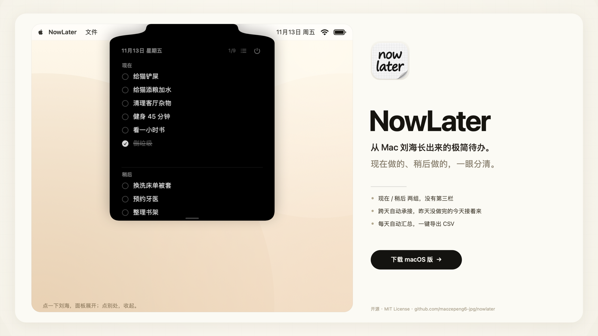
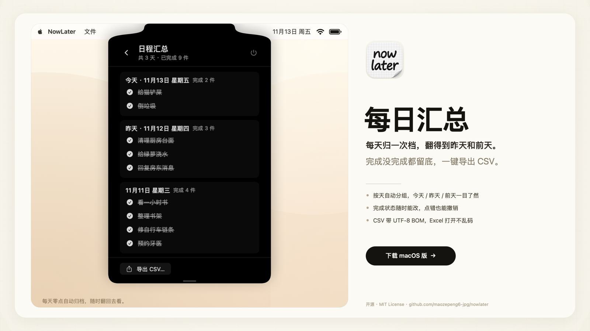

# NowLater

> 藏在 Mac 刘海（灵动岛）里的极简待办：**现在 / 稍后**，别的一概没有。

平时屏幕上什么都看不到。鼠标移到刘海那里点一下，面板就从刘海里长出来；点别处或按 Esc，它就缩回去。整包不到 3 MB，不需要 Xcode，一条脚本编译。



## 功能

- **现在 / 稍后 两组**，中间一条分隔线，没有第三栏
- **双击刘海**开合；点击外部、按 Esc 收起
- **点文字直接编辑**，把文字删空就是删除
- **拖动排序**：组内拖到哪插到哪，拖过分隔线就换组
- **拖动面板边缘**自由缩放（最大 2 倍）
- **每日汇总**：按天自动归档，完成/未完成都留底；右上按钮打开汇总窗口，可导出 CSV
- **跨天承接**：今天没做完的（包括「稍后」里的），明天自动接着出现，带「承接」标记
- **⌘C / ⌘V / ⌘A / ⌘Z** 全可用；多行文本粘贴自动拆成多条
- 右键任一任务：编辑 / 拷贝文字
- 数据在本地 `~/Library/Application Support/NowLater/`，纯 JSON，重启不丢



## 安装

方式一：直接下成品
- Releases 里下载 `NowLater-x.y.z.zip`，解压拖到「应用程序」。
- 首次打开若被 Gatekeeper 拦：系统设置 → 隐私与安全性 → 仍要打开。（Ad-hoc 签名，无公证。）

方式二：自己编译（只需命令行工具，不用装 Xcode）

```bash
xcode-select --install        # 如果还没装过 CLT
git clone <repo-url>
cd nowlater
./build.sh                    # 产出 build/NowLater.app，< 3 MB
cp -R build/NowLater.app /Applications/
open /Applications/NowLater.app
```

> 注：构建脚本写死了 CLT 的 `MacOSX26.5.sdk`（新版 CLT 的 SDK 与 swiftc 有兼容问题）。如果你的 SDK 版本不同，改 `build.sh` 里的 `SDK=` 一行即可。

## 用法

| 动作 | 结果 |
| --- | --- |
| 双击刘海区域 | 展开 / 收起 |
| 点面板外 / Esc | 收起 |
| 点某条文字 | 原地编辑；删空 = 删除 |
| 拖动某条 | 换序；跨过分隔线 = 换到「现在/稍后」 |
| 拖面板左右/下边缘 | 调整大小（最宽/最高 2 倍） |
| 右上角电源图标 / ⌘Q | 退出（会先确认） |

## 技术

- 纯 Swift + SwiftUI/AppKit，无第三方依赖，无 Xcode 工程文件，`build.sh` 直接调 `swiftc`
- 刘海面板：`NSPanel`（borderless + nonactivatingPanel），level `.statusBar`；点击刘海靠全局事件监听（系统不会把刘海处的点击送进第三方窗口）
- 展开动画时窗口顶部贴屏幕最上沿，卡片上角直角、下角圆角，视觉上就是刘海的延伸
- 每日汇总：`Store` 内「只合并不覆盖」的当日累计 + 跨天 rollover 归档
- 图标由图像模型生成（提示词见 `Design/icon-prompt.txt`），RGB+alpha ICNS（灰度编码会让 macOS 套一层灰框）

## 目录结构

```
Sources/     全部源码（Store / IslandView / NotchController / PanelView / HistoryView …）
Tests/       各版本回归测试与结果
Design/      图标源图、生成提示词、打包脚本
Resources/   AppIcon.icns
build.sh     一条命令构建 + 签名 + 体积检查（<3 MB）
```

## License

MIT
